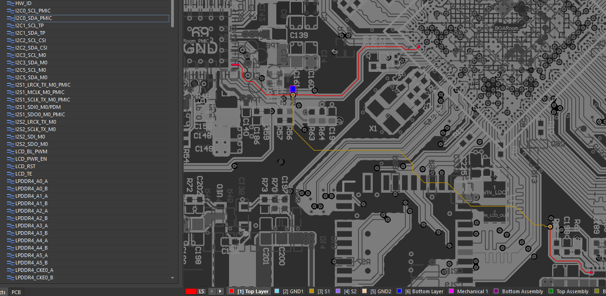

## 初始电源域验证
由于RK3566芯片引脚比较密集，且身边没有比较专业的BGA焊接设备，为了保险，我选择直接在裸板贴了两片SOC，避免淘到有问题的芯片和手工焊接引起的虚焊等风险，并使用万用表蜂鸣档对各电源域进行测量，作为基准记录，以这种方法来来观察是否电路正常。
（-代表无穷大，X代表数值反复横跳，？代表调一下数值变成无穷大）
  | 电源域 | 只有SOC   | 焊接SOC背面电容 | 焊接PMIC | 上电后电压  | 焊接DDR后 | 
  | :----- | :------: | -----:         |  -----:  | -----: | -----:   |
  | VDD_LOGIC  | 50.1Ω  | 60.1Ω   |   70Ω      |    0.9v   |          |
  | VDD_GPU  | 110Ω     | 111Ω    |   0.053v   |   0.8v    |          |
  | VDD_CPU  | 0.053v   |  114Ω   |  114.8Ω    |   1.03v   |          |
  | VDD_NPU  |  0.124v  | 0.115v  |   0.137v  |    0v      |          |
  | VCC_1V8  | 1.128V   |  0.817v  |   0.859v  |   1.79v   |          |
  | VCC_DDR  | 0.245v   | 0.430v   |   0.442v   |   1.11v  | 0.078v   |   
  | VDDA0V9_IMAGE  | 0.563v    | 0.510v  | 0.513v |   0v   |          |
  | VDDA_0V9 | 0.698v    | 0.631v  | 0.646v    |    0v     |          |
  | VDDA0V9_PMU  | 0.999v| 0.991v  | 0.992v    |   0.9v    |          |
  | VCCIO_ACODEC | 1.64v | 0.964v  |  0.951v   |    0v     |          |
  | VCCIO_SD  | 1.68v    |  0.943v |  1.079v   |   3.2v    |          |
  | VCC3V3_PMU | 1.263v  | 0.198v  |  0.907v   |  3.28v    |          |
  | VCCA_1V8  | 0.732v    | 1.0v    |  1.182v  |   1.8v    |          |
  | VCCA1V8_PMU |  -     |  -      |    x      |  1.8v     |          |
  | VCCA1V8_IMAGE  |  1.935v |  ？  |    ？    |   0v       |          |
  | VCC3V3_SD |  -       |  -      |     x     | 3.28v     |          | 
  | VCC_3V3  | 0.762v    | 0.87v   |   0.797v  |  3.28v    |          |
  | VCC3V3_SYS |  -      |  -      |      ?    |  3.28v    |          |

## 焊接PMIC阶段
发现问题：有几处LOD输出有跳变，怀疑是这一路电源的电容没有焊接好，但是6层的板子GND比较大，电烙铁拆电容太难了，好再这几处的电源路径上电容比较少，仔细观察后没有发现明显的短路痕迹，又看到PMIC的引脚的焊接状态比较不好，我又怀疑PMIC的问题，无奈重新吹了一遍，，但是发现还是这个状态，于是使用万用表反向测量（黑表笔接被测段，红表笔接地）发现都是稳定在0.42v左右，最终把可调电源限流200ma后上电，电流此时稳定在100ma，测量这两个测试点后，发现这两个电压正常稳定在各自的电压范围，这就很奇怪了？

## 焊接DDR阶段
  非常幸运的是，在内存没有涨价前买了两片LPDDR4 2G，大概一个30，现在涨价到100了... 相对于RK3566这种密集的引脚来说，LPDDR4的焊接还是相对比较简单的，焊接的压力也比较小，热风枪拿掉风嘴，3档350°C轻松完成，在焊接完成后测量发现VCC_DDR这路的压降下降到0.078v，查找资料后发现是LPDDR4内部有大量的ESD和多个DDR芯片并联导致的正常现象。

 ## 烧录MiniloaderAll.bin测试
  在焊接完成PMIC、SOC和DDR后，在电脑上安装瑞芯微的驱动，这里有个坑，我之前下载的Driverassistant不是最新版的，导致驱动识别不成功，复盘后发现这个版本还没有包含RK3566的驱动。下载最新版后，打开烧录软件已经显示找到了一个Maskrom设备，在烧录完成MiniloaderAll.bin后，成功的读取到了芯片的信息。
  
  
## 26/4/15 编译镜像阶段
 在确认当前电路正常后，我便着手准备开始烧录系统事宜，当然，在我绘制PCB阶段，也买了块开发板学习了一下，稍微的补偿了一下Liunx的基础知识，我使用的SDK是野火的LubanCat_Linux_rk356x_SDK,但在编译系统的过程中，也是遇到了很多的问题。

**问题1：设备树的选择**
- 鲁班猫的板卡是根据ADC采样的值来自动选择dts文件的，但我的硬件上面没有此设计，于是我各种查阅资料，好在网上有大佬也搞过这个SDK，虽然芯片不一样，但是也有迹可循。
- 解决：由于我编译的是Debian系统，所以在SDK目录下的Debian/overlay/etc/init.d的boot_init.sh这个文件里面修改，将函数board_info()下RK3566判断下的0100改为自己的dts文件名，
  ```
		0100)
				BOARD_NAME='LubanCat-1N'
				BOARD_DTB='rk3566-myboard.dtb'
				BOARD_uEnv='uEnv.txt'
  ```
并且更改board_id()函数如下 注释掉获取ADC值的步骤，直接填写BOARD_ID的值去对应board_info()函数判断的值，这样在uboot结束后就会指向你的dts文件。
  ```
board_id() {
	#ADC_voltage_scale=$(cat /sys/bus/iio/devices/iio\:device0/in_voltage_scale)
	#echo "ADC_voltage_scale:"$ADC_voltage_scale

	SOC_type=$(cat /proc/device-tree/compatible | cut -d,  -f 3 | sed 's/\x0//g')
	echo "SOC_type:"$SOC_type

	#ADC_CH2_RAW=$(cat /sys/bus/iio/devices/iio\:device0/in_voltage2_raw)
	#echo "ADC_CH2_RAW:"$ADC_CH2_RAW
	#ADC_CH3_RAW=$(cat /sys/bus/iio/devices/iio\:device0/in_voltage3_raw)
	#echo "ADC_CH3_RAW:"$ADC_CH3_RAW

	#get_index $ADC_CH2_RAW
	#ADC_CH2_INDEX=$INDEX

	#get_index $ADC_CH3_RAW
	#ADC_CH3_INDEX=$INDEX

	BOARD_ID="0100"
	echo "BOARD_ID:"$BOARD_ID
}
  ```

**问题2：Debian10系统已结束生命周期**
- 编译Debian系统还需要在线下载一些文件，种种原因导致编译不通过。
- 解决：更换了Debian/ubuntu-build-service/buster-lite-arm64下的config的lb config\下地址更改为国内源
```
lb config \
 --mirror-bootstrap "https://mirrors.aliyun.com/debian-archive/debian" \
 --mirror-chroot "https://mirrors.aliyun.com/debian-archive/debian" \
 --mirror-chroot-security "https://mirrors.aliyun.com/debian-archive/debian-security" \
 --mirror-binary "https://mirrors.aliyun.com/debian-archive/debian" \
 --mirror-binary-security "https://mirrors.aliyun.com/debian-archive/debian-security" \
```
 但是编译时，还是出现问题，这次的提示是

>     zjqsg@ubuntu:~/SDK/debian$ lb config \
>     --distribution buster \
>     --archive-areas "main contrib non-free" \
>     --mirror-bootstrap http://archive.debian.org/debian \
>     --mirror-chroot http://archive.debian.org/debian \
>     --mirror-binary http://archive.debian.org/debian \
>     --parent-mirror-chroot-security http://archive.debian.org/debian-security \
>     --parent-mirror-binary http://archive.debian.org/debian \
>     --apt-options "--yes -o Acquire::Check-Valid-Until=false"
> 	  --[2026-04-15 20:28:21] lb config --distribution buster --archive-areas main contrib non-free --mirror-bootstrap http://archive.debian.org/debian --mirror-chroot >http://archive.debian.org/debian --mirror-binary
>		http://archive.debian.org/debian --parent-mirror-chroot-security http://archive.debian.org/debian-security --parent-mirror->binary http://archive.debian.org/debian --apt-options --yes -o Acquire::Check-Valid-Until=false
>		P: Creating config tree for a ubuntu/buster/amd64 system
>		zjqsg@ubuntu:~/SDK/debian$

- 解决：询问Agent后是说由于存档库中的 Release 文件已过期，其数字签名可能不再被系统信任，这可能导致构建过程因验证失败而中断，故找到野火客服咨询，给出的办法是将--debootstrap-options替换为下面的代码。
```
--debootstrap-options "--variant=minbase --include=apt-transport-https,gnupg --keyring=/usr/share/keyrings/debian-archive-removed-keys.gpg" \
```
**小节：
	构建Debian10系统比较坑，耗时很长，最好前期把该搞的都搞好，构建好一次，下次就不需要重新构建了，如果需要修改设备树文件，只单独构建boot.img文件，重新打包就好了，具体教程可以看野火的文档 “嵌入式Linux镜像构建与部署——基于LubanCat-RK系列板卡”**

## 烧录镜像阶段

**问题1：发现串口没有输出日志**

在编译完成程序并烧录后，插上SD卡，上电后电流大概140ma，比没插SD卡前多了20ma，连接上调试串口后，并且终端非常卡，按下复位按键后，电流下降上升正常，于是我检查了原理图和PCB，两条线路之间只串联了一个电阻，感觉是这个电阻的问题，拆下万用表一量100Ω，估计是自己焊接的时候拿错料了，本来可以换上22欧，为了不想再返工拆，直接换上了0欧电阻。

可是上电后，还是没有日志被打印，于是之前烧录MiniloaderAll.bin测试时能检查到芯片ID，可以判断soc和pmic暂时是没问题的，、可能问题就出在系统镜像和SD卡槽的焊接上了，于是又检查了相关的原理图和PCB部分，连接也是没有问题的，于是我询问了一下AI,AI表示可能是设备树&sdmmc0 节点有问题，于是我又检查并对比了一下官方的设备树配置，是一样的，但是出于怀疑，也跟着AI指导改了一下，一顿“构建-打包-烧录”搞得我脑袋都大了，最后，我都怀疑是SD卡有问题了... 但是换了个SD卡还是不行，实在没办法了，我就把我构建的系统烧录到鲁班猫开发板上了，振奋的是串联打印出来日志了，这是个好的开始。

于是我可以确定sd卡和系统镜像是暂时没问题的，而且PCB的线路也是没问题的，那就是焊接的问题了，果然，在pcb正面的sdmmc0_ckl的串联电阻没有焊接.... 焊接完成了，这个问题解决了，系统成功加载uboot，并且成功切换到了我的设备树文件。

**问题2：开启npu导致kernel Panic**
	解决了串口问题后，电流上升到了200ma作用，进入Kernel后出现错误，日志最后end Kernel panic - not syncing: panic_on_set_idle set ... 喂给AI后表示是npu电源域导致的内核panic。

解决方法：将npu相关的节点的status状态由okay改为disabled，如下所示。（暂时不寻找原因，先进入系统再说）
```
&rknpu {
	rknpu-supply = <&vdd_npu>;
	status = "okay";
};

&rknpu_mmu {
	status = "okay";
};

&bus_npu {
	bus-supply = <&vdd_logic>;
	pvtm-supply = <&vdd_cpu>;
	status = "okay";
};

```

**问题3： ALERT!  /dev/mmcblk1p3 does not exist.  Dropping to a shell!**

	解决了npu相关的问题，问题来到了这个地方，日志最后提示
>	Gave up waiting for root file system device.  Common problems:
>	Boot args (cat /proc/cmdline)
> 	Check rootdelay= (did the system wait long enough?)
> 	Missing modules (cat /proc/modules; ls /dev)
>	ALERT!  /dev/mmcblk1p3 does not exist.  Dropping to a shell!

由于此时对系统还不是很了解，走了很多弯路，网上和我这个情况相似的基本没有几个，也没有找到办法，但是呼吸灯已经闪起来了，看起来设备树的已经成功加载了？于是还是先喂AI,AI表示可能有以下原因
1. SD卡实际分区和Bootargs的root=/dev/mmcblk1p3不一致
2. 烧录时镜像没有被正确创建，
排查和解决：针对这些可能，我首先是根据AI指导，先把使用lsblk查看了SD卡UUID，放在了dts里面，并且删除了其他的bootargs防止覆盖，然而并没有什么用，无果，疯狂找资料，各种尝试，我又怀疑是SD卡的问题了... 这个问题又卡了我好几天，于是把镜像烧录到了之前买的鲁班猫上，发现最后也是卡在了这个地方？但是，通过鲁班猫的启动日志和我的对比我发现了一个让我之前忽略的地方，其中有一行
>	我的板子日志  [    0.986422] rk808 0-0020: chip id: 0x0

>	鲁班猫日志    [    0.208999] rk808 0-0020: chip id: 0x8090

I2C没有识别到PMIC！有可能是这个原因导致的后面的出错，于是我先着手解决这个问题。

**问题4：检测不到rk809-5和tcs4525的地址**

起初，我怀疑是上拉电阻的原因，之前使用的是2.2k，但是换上4.7k后还是检查不到。然后测量上拉电阻的电压，3.3V正常，但是还是不行。然后，我又去PCB查看i2c的走线，看起来也还是没问题的。



由于芯片底下没有引出测试点，我只能测量从上拉到PMIC的通断，结果还是没问题，最后，我怀疑是SOC是不是被我用热风枪搞来搞去搞虚焊了... 于是我想起来量了一下I2C的对地通断，发现是I2C的SDA对地短路。那就是RK809或者tcs4525的SDA短路了，我宁愿相信rk809有问题都不会想tcs4525会有问题，因为tcs4525是BGA的，焊接麻烦，但是现实是我卸掉rk809，SDA还是对地短路，没办法了，还是卸掉了Tcs4525，清理焊盘的时候差点就把焊盘搞废掉了，tcs4525下面的几个地的绿油都搞掉了... 实在不想再焊接一版了，硬着头皮焊上去了，万幸没有短路，最后，出乎意料的顺利，上电后成功进入系统，看来**问题3**的问题就是这个导致的。

**到此，系统成功启动，由于只能在下班的时候搞，大概花了2周，在焊接和调试中遇到了很多问题，但同时也锻炼了BGA芯片的焊接、解决问题的思路和调试能力。也解了LInux的基础命令和RK的系统构建方法，本文档是对自己这个调试过程的复盘，也希望能对大家有点帮助**
