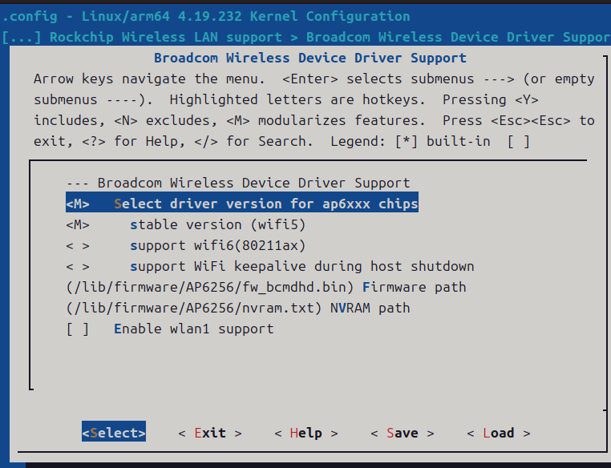
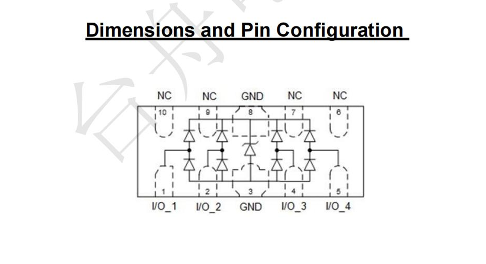

## 外设调试记录
在bringup成功后，我开始了外设的焊接调试

##USB2.0/3.0调试
USB2.0/3.0的调试比较简单，在焊接完成外围电路后，在DTS里面添加
```
/* USB Host_2/USB Host_3 USB 2.0 Comb */
&usb2phy1 {
	status = "okay";
};

&u2phy1_otg {
	status = "okay";
};

&u2phy1_host {
	status = "okay";
};

&usb_host1_ehci {
	status = "okay";
};

&usb_host1_ohci {
	status = "okay";
};

/* USB3.0 OTG Only USB2.0 */
&usbdrd30 {
	status = "okay";
};

&usbdrd_dwc3 {
	status = "okay";
};

/* USB3.0 Host */
&combphy1_usq {
	status = "okay";
};

&usbhost30 {
	status = "okay";
};

&usbhost_dwc3 {
	status = "okay";
};
```
烧录后

## AP6212适配固件

由于使用的鲁班猫SDK中没有适配AP6212的固件，所以要手动适配，第一步是要配置menuconfig，
在sdk的kernel目录使用
···
make ARCH=arm64 lubancat2_defconfig menuconfig
···
按下/键搜索，输入AP6，第一个就是，按下1，即可跳转，先将设置
```
[*]   Broadcom Wireless Device Driver Support  --->
```
进入选项后，如图所示，设置固件的地址


## HDIM调试
  bringup时使用是Debian lite的镜像，为了使用HDMI，我重新构建了xfec的镜像系统，我先通过VNC远程桌面测试了一下，结果很好，成功的显示了桌面，然后我在dts里面使用了鲁班猫的HDMI头文件，但是在连接到显示器的时候出现了问题，部分日志如下，在uboot阶段
```
hdmi@fe0a0000:  detailed mode clock 148500 kHz, flags[5]
    H: 1920 2008 2052 2200
    V: 1080 1084 1089 1125
bus_format: 2025
VOP update mode to: 1920x1080p60, type: HDMI0 for VP0
VP0 set crtc_clock to 148500KHz
VOP VP0 enable Smart0[772x525->772x525@574x277] fmt[1] addr[0x7e029000]
CEA mode used vic=16
final pixclk = 148500000 tmdsclk = 148500000
PHY powered down in 0 iterations
PHY PLL locked 1 iterations
PHY powered down in 0 iterations
PHY PLL locked 1 iterations
sink has audio support
hdmi_set_clk_regenerator: fs=48000Hz ftdms=148.500MHz N=6144 cts=148500
```

在内核阶段
```
[    0.199586] rockchip-drm display-subsystem: Linked as a consumer to fe0a0000.hdmi
[    0.201661] dwhdmi-rockchip fe0a0000.hdmi: Detected HDMI TX controller v2.11a with HDCP (DWC HDMI 2.0 TX PHY)
[    0.202246] dwhdmi-rockchip fe0a0000.hdmi: registered DesignWare HDMI I2C bus driver
[    0.202827] rockchip-drm display-subsystem: bound fe0a0000.hdmi (ops 0xffffff80090fbe08)
[    0.447556] rockchip-vop2 fe040000.vop: [drm:vop2_crtc_atomic_disable] Crtc atomic disable vp0
[    0.464625] rockchip-vop2 fe040000.vop: [drm:vop2_crtc_atomic_enable] Update mode to 2560x1440p60, type: 11 for vp0
[    0.485189] dwhdmi-rockchip fe0a0000.hdmi: Rate 241500000 missing; compute N dynamically
[    0.548362] rockchip-drm display-subsystem: fb0:  frame buffer device
[    0.549276] [drm] Initialized rockchip 2.0.0 20140818 for display-subsystem on minor 0
```  
看起来已经识别到了显示屏，进入系统后运行命令可以看到状态也是正常的,但是屏幕还是黑的。
```
root@lubancat:~# cat /sys/class/drm/card0-HDMI-A-1/status
connected
root@lubancat:~# cat /sys/class/drm/card0-HDMI-A-1/modes
2560x1440
2560x1440
1920x1080
1920x1080
1920x1080
1920x1080
1920x1080i
1920x1080i
1920x1080
1920x1080i
1280x1440
1680x1050
1280x1024
1280x1024
1440x900
1280x960
1280x720
1280x720
1280x720
1280x720
1024x768
1024x768
1024x768
832x624
800x600
800x600
800x600
800x600
720x576
720x576
720x480
720x480
720x480
720x480
640x480
640x480
640x480
640x480
640x480
640x480
720x400
root@lubancat:~# echo on > /sys/class/drm/card0-HDMI-A-1/status
```
有了之前的调试经验和思路，我先检查了焊接的部分，其中两个ESD焊点不饱满，我就重新焊接了一下，由于HDMI外围电路很简单，我就没有检查仔细检查原理图，然后就开始了软件上的各种折腾...最后还是没搞好，然后我用万用表打了一下通断，**发现信号在ESD两端短路了**，通过查看类似芯片的手册和泰山派的原理图，我发现在ESD的两端引脚内部不是连起来的，这真是一个很不应该出现的错误，因为copy原理图符号的时候没有注意，以为esd内部是相通的，所以导致了这个问题...。
如下图
<div align="center">



解决方法就是把这些引脚都短路掉，焊接完成后，成功的显示了HDMI.
