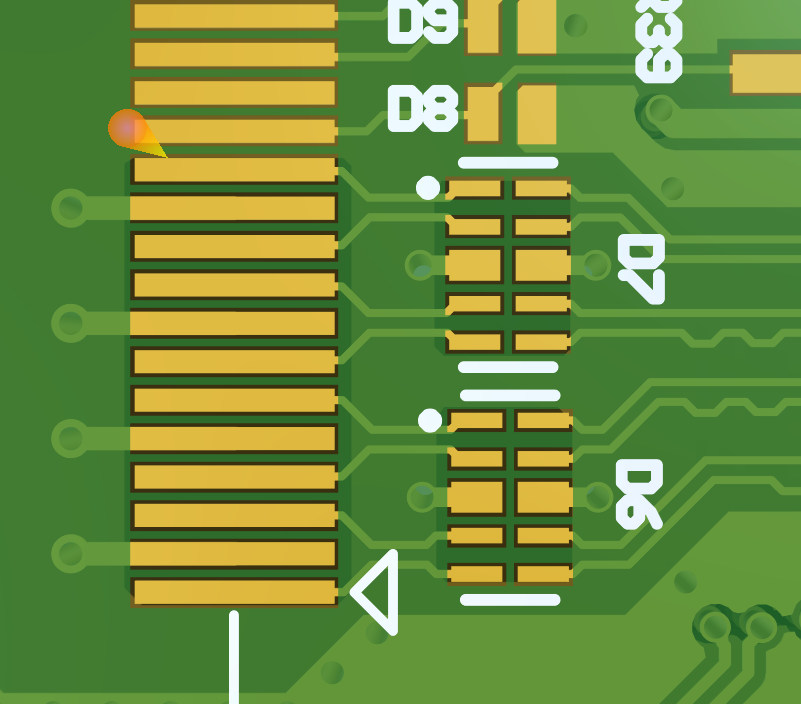

## 外设调试记录
在bringup成功后，我开始了外设的焊接调试

##USB2.0/3.0调试
USB2.0/3.0的调试比较简单，在焊接完成外围电路后，在DTS里面添加
```
/* USB Host_2/USB Host_3 USB 2.0 Comb */
&usb2phy1 {
	status = "okay";
};

&u2phy1_otg {
	status = "okay";
};

&u2phy1_host {
	status = "okay";
};

&usb_host1_ehci {
	status = "okay";
};

&usb_host1_ohci {
	status = "okay";
};

/* USB3.0 OTG Only USB2.0 */
&usbdrd30 {
	status = "okay";
};

&usbdrd_dwc3 {
	status = "okay";
};

/* USB3.0 Host */
&combphy1_usq {
	status = "okay";
};

&usbhost30 {
	status = "okay";
};

&usbhost_dwc3 {
	status = "okay";
};
```
烧录后，插入u盘可正常读取文件，并且插入鼠标等设备也可以正常识别。

# AP6212/6256无线网卡
## 1.固件适配
由于使用的鲁班猫SDK中没有适配AP6212/AP6256的固件，所以要手动适配，第一步是要配置menuconfig，
在sdk的kernel目录运行
···
make ARCH=arm64 lubancat2_defconfig menuconfig
···
按下/键搜索，输入AP6，第一个就是，按下1，即可跳转，先将设置
```
[*]   Broadcom Wireless Device Driver Support  --->
```
进入选项后，如图所示并设置固件的地址。


我以AP6256为例子，如果你的是AP6212，可以设置为
```
lib/firmwar/AP6212/fw_bcm43438a0.bin (根据AP212的版本选择A0还是A1)
lib/firmwar/AP6212/nvram.txt
```
更改成功后，保存后退出，运行make ARCH=arm64 savedefconfig更新配置文件。
使用cp defconfig arch/arm64/configs/rockchip_linux_defconfig替换默认配置文件。

由于我已经调通USB端口，所以可以使用读卡器或者U盘将固件拷贝到系统的lib/firmware/AP6256里面。
另外一种方法就是在编译系统的过程中将固件文件复制到SDK/debian/overlay-firmware/usr/lib/firmware里面，在构建debian系统时会自动添加进去。


## 2.dts设备树适配（只适测试了wifi，蓝牙还没有搞）
在根节点下配置AP6256的电源引脚和中断配置引脚,AP6212只需要修改wifi_chip_type = "ap6212"即可
```
/{
	sdio_pwrseq: sdio-pwrseq {
		compatible = "mmc-pwrseq-simple";
		clocks = <&rk809 1>;
		clock-names = "ext_clock";
		pinctrl-names = "default";
		pinctrl-0 = <&wifi_enable_h>;
		post-power-on-delay-ms = <200>;
		reset-gpios = <&gpio2 RK_PB1 GPIO_ACTIVE_LOW>;
	};

	wireless_wlan: wireless-wlan {
		compatible = "wlan-platdata";
		pinctrl-names = "default";
		pinctrl-0 = <&wifi_host_wake_irq>;
		WIFI,host_wake_irq = <&gpio2 RK_PB2 GPIO_ACTIVE_HIGH>;
		rockchip,grf = <&grf>;
		wifi_chip_type = "ap6256";
		status = "okay";
	};
};
```
在根节点后追加SDIO1的配置和pinctrl引脚控制器节点
```
&sdmmc1 {
	max-frequency = <150000000>;
	supports-sdio;
	bus-width = <4>;
	disable-wp;
	cap-sd-highspeed;
	cap-sdio-irq;
	keep-power-in-suspend;
	mmc-pwrseq = <&sdio_pwrseq>;
	non-removable;
	pinctrl-names = "default";
	pinctrl-0 = <&sdmmc1_bus4 &sdmmc1_cmd &sdmmc1_clk>;
	sd-uhs-sdr104;
	status = "okay";
};

&pinctrl {
	sdio-pwrseq {
		wifi_enable_h: wifi-enable-h {
			rockchip,pins = <2 RK_PB1 RK_FUNC_GPIO &pcfg_pull_none>;
		};
	};

	wireless-wlan {
		wifi_host_wake_irq: wifi-host-wake-irq {
			rockchip,pins = <2 RK_PB2 RK_FUNC_GPIO &pcfg_pull_down>;
		};
	};
	
};
```
到此，AP6256的固件（wifi）就适配好了，但是在我烧录镜像后，发现并没有成功，因为系统没有.ko文件，在查阅资料后，发现是普遍的是将.ko文件打包成deb包，目的便于升级和维护。
于是在SDK目录下面发现了这些deb包，解压复制data里的modules文件，复制到系统的lib目录下，但是reboot后，发现信号非常差，由于我当时绘制射频线的时候这根线没有匹配阻抗，经过计算现在的阻抗是27欧左右，由于手头没有比较专业的设备，只能连接上wifi使用iw dev wlan0 link 来查看

## 以太网调试
# dts设备树适配
焊接完成后，先在dts文件里面添加头文件 include <dt-bindings/phy/jlsemi-dt-phy.h> 然后添加结点
```
&gmac1 {
	phy-mode = "rgmii";
	clock_in_out = "output";

	snps,reset-gpio = <&gpio0 RK_PC3 GPIO_ACTIVE_LOW>;
	snps,reset-active-low;
	/* Reset time is 100ms, 100ms */
	snps,reset-delays-us = <0 75000 100000>;

	assigned-clocks = <&cru SCLK_GMAC1_RX_TX>, <&cru SCLK_GMAC1>;
	assigned-clock-parents = <&cru SCLK_GMAC1_RGMII_SPEED>, <&cru CLK_MAC1_2TOP>;
	assigned-clock-rates = <0>, <125000000>;

	pinctrl-names = "default";
	pinctrl-0 = <&gmac1m1_miim
			 &gmac1m1_tx_bus2_level3
			 &gmac1m1_rx_bus2
			 &gmac1m1_rgmii_clk_level2
			 &gmac1m1_rgmii_bus_level3>;

	// RTL8211F
	// tx_delay = <0x24>;
	// rx_delay = <0x08>;

	// JL2101
	// tx_delay = <0x1a>;
	// rx_delay = <0x08>;

	tx_delay = <0x24>;
	rx_delay = <0x08>;

	phy-handle = <&rgmii_phy1>;
	status = "okay";
};

&mdio1 {
	rgmii_phy1: phy@0 {
		compatible = "ethernet-phy-ieee802.3-c22";
		reg = <0x0>;
		jl2xxx,led-enable = <(JL2XXX_LED_STATIC_OP_EN | JL1XXX_LED_MODE_EN)>;
		jl2xxx,led-mode = <(JL2XXX_LED1_LINK10  | \
				 JL2XXX_LED1_LINK100  | \
				 JL2XXX_LED1_LINK1000 | \
				 JL2XXX_LED2_LINK10   | \
				 JL2XXX_LED2_LINK100  | \
				 JL2XXX_LED2_LINK1000 | \
				 JL2XXX_LED2_ACTIVITY )>;
	};
};

```
但是在替换掉设备树文件后，日志中有
```
root@lubancat:~# dmesg | grep -i gmac
[    0.217992] rk_gmac-dwmac fe010000.ethernet: Looking up phy-supply from device tree
[    0.218010] rk_gmac-dwmac fe010000.ethernet: Looking up phy-supply property in node /ethernet@fe010000 failed
[    0.218021] rk_gmac-dwmac fe010000.ethernet: no regulator found
[    0.218057] rk_gmac-dwmac fe010000.ethernet: clock input or output? (output).
[    0.218080] rk_gmac-dwmac fe010000.ethernet: TX delay(0x24).
[    0.218099] rk_gmac-dwmac fe010000.ethernet: RX delay(0x8).
[    0.218124] rk_gmac-dwmac fe010000.ethernet: integrated PHY? (no).
[    0.223190] rk_gmac-dwmac fe010000.ethernet: init for RGMII
[    0.223435] rk_gmac-dwmac fe010000.ethernet: User ID: 0x30, Synopsys ID: 0x51
[    0.223463] rk_gmac-dwmac fe010000.ethernet:         DWMAC4/5
[    0.223481] rk_gmac-dwmac fe010000.ethernet: DMA HW capability register supported
[    0.223501] rk_gmac-dwmac fe010000.ethernet: RX Checksum Offload Engine supported
[    0.223522] rk_gmac-dwmac fe010000.ethernet: TX Checksum insertion supported
[    0.223540] rk_gmac-dwmac fe010000.ethernet: Wake-Up On Lan supported
[    0.223587] rk_gmac-dwmac fe010000.ethernet: TSO supported
[    0.223607] rk_gmac-dwmac fe010000.ethernet: Enable RX Mitigation via HW Watchdog Timer
[    0.223630] rk_gmac-dwmac fe010000.ethernet: TSO feature enabled
[    5.069970] rk_gmac-dwmac fe010000.ethernet eth0: Could not attach to PHY
[    5.070009] rk_gmac-dwmac fe010000.ethernet eth0: stmmac_open: Cannot attach to PHY (error: -19)
[    6.133653] rk_gmac-dwmac fe010000.ethernet eth0: Could not attach to PHY
[    6.133671] rk_gmac-dwmac fe010000.ethernet eth0: stmmac_open: Cannot attach to PHY (error: -19)
[    6.185072] rk_gmac-dwmac fe010000.ethernet eth0: Could not attach to PHY
[    6.185091] rk_gmac-dwmac fe010000.ethernet eth0: stmmac_open: Cannot attach to PHY (error: -19)
[    6.205285] rk_gmac-dwmac fe010000.ethernet eth0: Could not attach to PHY
[    6.205305] rk_gmac-dwmac fe010000.ethernet eth0: stmmac_open: Cannot attach to PHY (error: -19)
[    6.225603] rk_gmac-dwmac fe010000.ethernet eth0: Could not attach to PHY
[    6.225620] rk_gmac-dwmac fe010000.ethernet eth0: stmmac_open: Cannot attach to PHY (error: -19)
[  306.103087] rk_gmac-dwmac fe010000.ethernet eth0: Could not attach to PHY
[  306.103116] rk_gmac-dwmac fe010000.ethernet eth0: stmmac_open: Cannot attach to PHY (error: -19)
[  306.123167] rk_gmac-dwmac fe010000.ethernet eth0: Could not attach to PHY
[  306.123193] rk_gmac-dwmac fe010000.ethernet eth0: stmmac_open: Cannot attach to PHY (error: -19)
[  306.142511] rk_gmac-dwmac fe010000.ethernet eth0: Could not attach to PHY
[  306.142536] rk_gmac-dwmac fe010000.ethernet eth0: stmmac_open: Cannot attach to PHY (error: -19)
[  306.161364] rk_gmac-dwmac fe010000.ethernet eth0: Could not attach to PHY
[  306.161393] rk_gmac-dwmac fe010000.ethernet eth0: stmmac_open: Cannot attach to PHY (error: -19)
```
 驱动初始化正常,但是最后还是连接不到PHY,然后万用表测量了3.3V .1.8V和RTL8211F的LDO内部电压输出引脚，8211F的LDO输出引脚发现电压为3.2v左右，由于LDO输出引脚的旁边是3.3V的电源输入，我以为是连锡导致的情况，但是通过通断档发现并没有短路，于是我开始检查原理图，并且和鲁班猫的原理图对比，确实发现电阻配置不一样，经过对比并且查询手册发现，我的
 ```
 LED0/CFG_EXT = 0
 LED1/CFG_LDO0 = 0
 LED2/CFG_LDO1 = 1
```
以上配置是配置外部IO
而鲁班猫的是
 ```
 LED0/CFG_EXT = 1
 LED1/CFG_LDO0 = 0
 LED2/CFG_LDO1 = 1
```
并且我的
而这个LED0/CFG_EXT的上下拉电阻配置的是RGMII接口I/O Pad的供电电压,而 LDO0=0,LDO1=1,通过手册可知外部电压为1.8V，也就是芯片28引脚的DVDD_RG 这个引脚的电压来源。
并且我的23引脚电阻没有焊接，在将23引脚上拉后，以太网通信正常，由于身边条件有限，只能使用电脑连接网线测试了一下，如下图，100MB


## HDIM调试
  bringup时使用是Debian lite的镜像，为了使用HDMI，我重新构建了xfec的镜像系统，我先通过VNC远程桌面测试了一下，结果很好，成功的显示了桌面，然后我在dts里面使用了鲁班猫的HDMI头文件，但是在连接到显示器的时候出现了问题，部分日志如下，在uboot阶段
```
hdmi@fe0a0000:  detailed mode clock 148500 kHz, flags[5]
    H: 1920 2008 2052 2200
    V: 1080 1084 1089 1125
bus_format: 2025
VOP update mode to: 1920x1080p60, type: HDMI0 for VP0
VP0 set crtc_clock to 148500KHz
VOP VP0 enable Smart0[772x525->772x525@574x277] fmt[1] addr[0x7e029000]
CEA mode used vic=16
final pixclk = 148500000 tmdsclk = 148500000
PHY powered down in 0 iterations
PHY PLL locked 1 iterations
PHY powered down in 0 iterations
PHY PLL locked 1 iterations
sink has audio support
hdmi_set_clk_regenerator: fs=48000Hz ftdms=148.500MHz N=6144 cts=148500
```

在内核阶段
```
[    0.199586] rockchip-drm display-subsystem: Linked as a consumer to fe0a0000.hdmi
[    0.201661] dwhdmi-rockchip fe0a0000.hdmi: Detected HDMI TX controller v2.11a with HDCP (DWC HDMI 2.0 TX PHY)
[    0.202246] dwhdmi-rockchip fe0a0000.hdmi: registered DesignWare HDMI I2C bus driver
[    0.202827] rockchip-drm display-subsystem: bound fe0a0000.hdmi (ops 0xffffff80090fbe08)
[    0.447556] rockchip-vop2 fe040000.vop: [drm:vop2_crtc_atomic_disable] Crtc atomic disable vp0
[    0.464625] rockchip-vop2 fe040000.vop: [drm:vop2_crtc_atomic_enable] Update mode to 2560x1440p60, type: 11 for vp0
[    0.485189] dwhdmi-rockchip fe0a0000.hdmi: Rate 241500000 missing; compute N dynamically
[    0.548362] rockchip-drm display-subsystem: fb0:  frame buffer device
[    0.549276] [drm] Initialized rockchip 2.0.0 20140818 for display-subsystem on minor 0
```  
看起来已经识别到了显示屏，进入系统后运行命令可以看到状态也是正常的,但是屏幕还是黑的。
```
root@lubancat:~# cat /sys/class/drm/card0-HDMI-A-1/status
connected
root@lubancat:~# cat /sys/class/drm/card0-HDMI-A-1/modes
2560x1440
2560x1440
1920x1080
1920x1080
1920x1080
1920x1080
1920x1080i
1920x1080i
1920x1080
1920x1080i
1280x1440
1680x1050
1280x1024
1280x1024
1440x900
1280x960
1280x720
1280x720
1280x720
1280x720
1024x768
1024x768
1024x768
832x624
800x600
800x600
800x600
800x600
720x576
720x576
720x480
720x480
720x480
720x480
640x480
640x480
640x480
640x480
640x480
640x480
720x400
```
有了之前的调试经验和思路，我先检查了焊接的部分，其中两个ESD焊点不饱满，我就重新焊接了一下，由于HDMI外围电路很简单，我就没有检查仔细检查原理图，然后就开始了软件上的各种折腾...最后还是没搞好，然后我用万用表打了一下通断，**发现信号在ESD两端断路了**，通过查看类似芯片的手册和的原理图，我发现在ESD的两端引脚内部不是连起来的，这真是一个很不应该出现的错误，因为copy原理图符号的时候没有注意，以为esd内部是相通的，所以导致了这个问题...。
如下图
<div align="center">



使用飞线将引脚连接上后再用热风枪把ESD器件吹上去，焊接完成后，万用表测试信号成功的传输了过去，插上显示屏后成功显示了画面。
