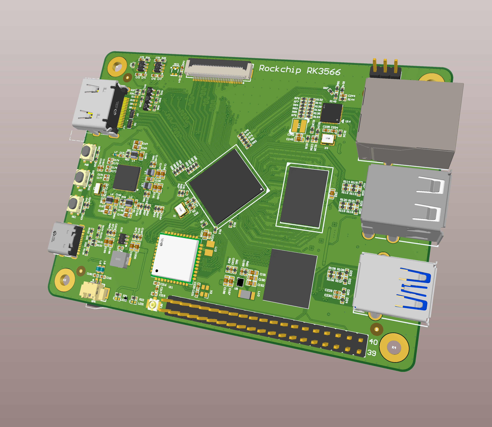

## 简介
    本项目是一个基于瑞芯微RK3566芯片的Linux开发板，个人兴趣和学习的驱动让我开始了这个项目。由于个人学习使用，没有过多在意外形，参考了很多rk3566开发板的外形，大致规划了板载资源和外设。

## 引出接口 
    USB2.0 *2 /USB3.0 *1 /HDMI *1 /MIPI DSI *1 /MIPI CSI *1 /以太网 *1 /MIC *1 /SPEAK *1 /40pin_GPIO *1 /3pin_DEBUG *1
## 板载资源
   SOC:RK3566 PMIC:RK809-5 WIFI/BT:AP6212 EMMC TF卡 LPDDR4/LPDDR4X 

## PCB外观图
    

    

    
