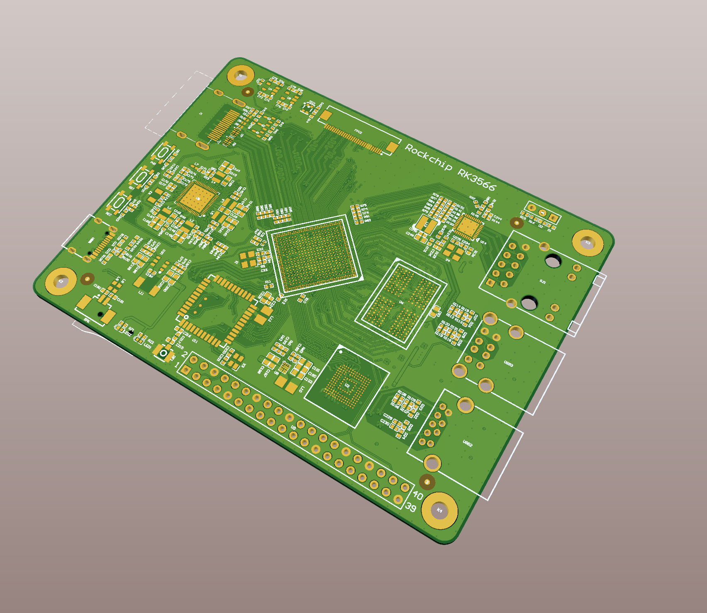

# RK3566 自定义最小系统板 Bring-up 项目

本项目是一个基于瑞芯微RK3566芯片的Linux开发板，个人兴趣和学习的驱动让我开始了这个项目，从裸 RK3566 芯片焊接、电源调试、硬件问题修复，到成功启动 Debian 系统的完整实战记录。

**当前状态**：✅ 已成功启动 Debian 10 Lite 系统（最小系统稳定运行）

**已完成的焊接**：
- SoC：RK3566
- PMIC：RK809
- CPU DCDC：TCS4525
- 内存：LPDDR4 2GB
- 存储：Micro SD 卡槽/EMMC
- 接口：USB2.0/3.0
- WIFI/BL:AP6212(更换AP6256)
- 以太网
- HDMI
  
**待焊接/调试**
- 40Pin GPIO排针（兼容鲁班猫1N）

这些外设将在设备稳定后逐步焊接，并编写对应的驱动和设备树节点。

**下一步计划**
- 解决npu导致内核Panic的问题
- 焊接验证以太网

## 项目亮点

- 从**裸芯片**开始完成完整 Bring-up
- 成功解决 I2C SDA 对地短路、pd_npu kernel panic 等多个硬件+软件问题
- 积累了丰富的电源域调试、设备树适配、启动流程优化经验

这是一个典型的**软硬结合**项目，展示了从硬件焊接到内核启动的全流程能力。

---

## 快速导航

- [详细 Bring-up 记录](./Docs/bringup-log.md)
- [硬件文件](./Hardware/)
- [设备树文件](./software/dts/rk3566-myboard.dts)
- [实物照片](./images/)

---

## 主要解决的问题

| 问题 | 现象 | 解决方法 |
|------|------|----------|
| I2C 无法识别 | 找不到PMIC器件，导致电源初始化失败，系统挂载失败 |
| 串口无输出 | 无日志 |
| Kernel Panic | pd_npu ack failed |
| AP6212固件适配 | --- | 移植AP6212固件 |
| HDMI | 屏幕黑屏，但日志状态已连接 |

更多细节请查看 [详细 Bring-up 记录](./Docs/bringup-log.md)。

---

## 待办事项

- 完善 power-controller 配置，正常开启 NPU
- 优化功耗与温度控制
- 压力测试
---

欢迎 Star、Issue 和讨论！

如果你也在做 RK356x 自定义板，欢迎交流经验。

    

    
